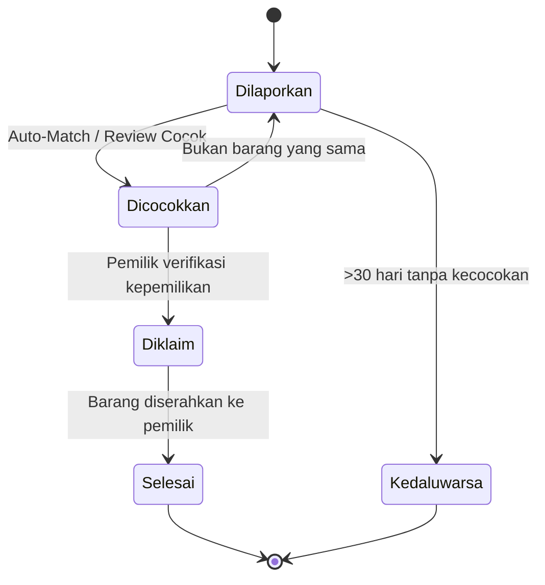

# 📦 LostBox — Sains Data Edition
> *"Barang hilang? Cek LostBox dulu."*

Projek Aplikasi Desktop Sistem *Lost & Found* Digital Berbasis Denah Interaktif dan *Auto-Matcher* Kecocokan Barang untuk Gedung Program Studi Sains Data (2 Lantai).

---

## 🎯 1. Identitas & Latar Belakang Masalah
Mahasiswa sering kehilangan barang di gedung prodi — charger laptop, flashdisk, tumbler, jaket, earphone, dompet, dan alat tulis. Masalah yang sering dihadapi:
1. ❌ Bertanya di grup WhatsApp $\rightarrow$ pesan cepat tenggelam.
2. ❌ Menitipkan pesan ke teman $\rightarrow$ lupa atau tidak tersampaikan.
3. ❌ Cek ke security/TU $\rightarrow$ belum ada sistem pencatatan terpusat yang rapi.
4. ❌ Pasrah $\rightarrow$ barang berharga tidak pernah kembali.

**LostBox** hadir sebagai solusi aplikasi satu atap terpusat khusus Gedung Prodi Sains Data yang memungkinkan mahasiswa:
- Melaporkan barang hilang atau barang temuan.
- Menandai lokasi secara visual pada peta denah lantai (Lantai 1 & Lantai 2).
- Mencocokkan laporan hilang dan temuan secara otomatis (*Auto-Matcher Engine*).
- Memantau status penanganan barang (*Lifecycle Status Tracker*).
- Menampilkan visualisasi data statistik (*Hotspot* ruangan rawan, kategori terbanyak, tingkat pengembalian).

---

## 👥 2. Pembagian Kerja Tim (3 Anggota)

| Anggota | Peran / Fokus | Modul & Tugas | Materi Python |
| :--- | :--- | :--- | :--- |
| **Anggota 1** | **Backend & Data Engine** | `src/models.py`<br>`src/data_manager.py` | OOP (Inheritance, Polymorphism), File Handling JSON, Exception Handling, ID Generator, Data Validation |
| **Anggota 2** | **Match Engine & Statistics** | `src/match_engine.py`<br>`src/data_manager.py` | Algoritma Scoring Kecocokan, Status Tracker Transition, Agregasi Statistik & Analitik |
| **Anggota 3** | **GUI & Interactive Floor Plan** | `src/ui/app.py`<br>`src/ui/map_view.py`<br>`src/ui/home_view.py`<br>`src/ui/report_view.py`<br>`src/ui/search_view.py`<br>`src/ui/stats_view.py` | CustomTkinter GUI, Frame Grid Floor Plan, Event Handling, Embedded Matplotlib Chart |

---

## 📚 3. Konsep Pemrograman Dasar Python yang Diterapkan

| Konsep Python | Implementasi Nyata di LostBox |
| :--- | :--- |
| **Variabel & Tipe Data** | Menyimpan data atribut barang (`str`, `int`, `float`), status, skor, flag pencocokan |
| **Percabangan (`if-elif-else`)** | Algoritma *scoring* kecocokan, validasi form, logika transisi status |
| **Perulangan (`for`, `while`)** | Iterasi daftar laporan, pencarian kata kunci, kalkulasi agregat statistik |
| **Fungsi (`def`) & Modularitas** | Modularisasi sistematis (`calculate_score()`, `filter_items()`, `get_statistics()`) |
| **List & Dictionary** | Koleksi laporan barang, representasi JSON, frekuensi kategori & hotspot |
| **Tuple & Set** | `Tuple` untuk koordinat lokasi `(floor, code, name)`, `Set` untuk token kata kunci dan filter |
| **File Handling** | Serialisasi & deserialisasi data JSON di direktori `data/` |
| **OOP (Object-Oriented)** | Hirarki kelas: `Location`, `Item` (Base Class), `LostItem` & `FoundItem` (Inheritance), `MatchEngine`, `DataManager` |
| **Exception Handling (`try-except`)** | `ValidationError` untuk input form tidak valid, penanganan `FileNotFoundError` dan `JSONDecodeError` |

---

## 🏗️ 4. Struktur Direktori Proyek

```
PROJEK/
├── data/
│   ├── settings.json         # Konfigurasi ruangan, kategori, warna, opsi sistem
│   ├── lost_items.json       # Database persisten laporan barang hilang
│   ├── found_items.json      # Database persisten laporan barang temuan
│   └── matches.json          # Riwayat konfirmasi pencocokan
├── src/
│   ├── __init__.py
│   ├── models.py             # Class Location, Item, LostItem, FoundItem
│   ├── match_engine.py       # Algoritma Auto-Matcher berbobot (0-100%)
│   ├── data_manager.py       # CRUD JSON, validasi input, agregator analitik
│   ├── sample_data.py        # 19 data dummy realistis (Skenario demo Ahmad & Budi)
│   └── ui/
│       ├── __init__.py
│       ├── app.py            # Window utama, sidebar navigasi, status bar, dark mode
│       ├── home_view.py      # Dashboard ringkasan (KPI cards, match & report terbaru)
│       ├── report_view.py    # Form Lapor Lost & Found + Tabel daftar laporan
│       ├── map_view.py       # Denah lantai interaktif ber-badge (Lantai 1 & 2)
│       ├── search_view.py    # Pencarian kata kunci & filter multi-parameter
│       ├── stats_view.py     # Grafik visualisasi Matplotlib terintegrasi
│       └── dialogs.py        # Modal detail, peninjauan match, dan mini floor picker
├── tests/
│   └── test_backend.py       # Unit testing otomatis backend logic
├── README.md                 # Dokumentasi proyek & panduan presentasi
└── projek.py                 # File utama entrypoint aplikasi
```

---

## ⚡ 5. Cara Menjalankan Program

### Prasyarat
- Python 3.10+ (atau Python 3.14)
- Pustaka pendukung: `customtkinter`, `matplotlib`, `numpy`, `pillow`

### Menjalankan Aplikasi Grafis (GUI Utama)
Jalankan perintah berikut di terminal:
```bash
python projek.py
```

### Menjalankan Mode Demonstrasi CLI (Headless / Terminal Only)
Sangat berguna untuk demonstrasi cepat di terminal atau lingkungan tanpa tampilan grafis:
```bash
python projek.py --cli
```

### Menjalankan Unit Test Backend
```bash
python -m unittest tests/test_backend.py
```

---

## 🗺️ 6. Denah Lantai Gedung Prodi (Floor Plan)

### Lantai 1
```
+-------------------------------------------------------------+
|                        LOBBY / HALL                         |
+--------------------+--------------------+-------------------+
|  Ruang Kuliah 101  |  Ruang Kuliah 102  |    Ruang Dosen    |
+--------------------+--------------------+-------------------+
|     Toilet L1      |       Tangga       |     TU / Admin    |
+--------------------+--------------------+-------------------+
|                 AREA PARKIR / TERAS DEPAN                   |
+-------------------------------------------------------------+
```

### Lantai 2
```
+-------------------------------------------------------------+
|                        KORIDOR ATAS                         |
+--------------------+--------------------+-------------------+
|  Lab Komputer 201  |    Lab Data 202    |  Ruang Kuliah 203 |
+--------------------+--------------------+-------------------+
|     Toilet L2      |       Tangga       |   Ruang Seminar   |
+--------------------+--------------------+-------------------+
|                 MUSHOLLA / RUANG MAHASISWA                  |
+-------------------------------------------------------------+
```

---

## 🧠 7. Algoritma Pencocokan Otomatis (*Auto-Matcher*)

Setiap kali ada laporan baru, `MatchEngine` menghitung skor kecocokan terhadap laporan yang relevan dengan pembobotan berikut:

$$\text{Total Score} = \text{Kategori} + \text{Warna} + \text{Lokasi} + \text{Waktu} + \text{Keyword}$$

1. **Kategori (Bobot: 30%)**: *Exact match* pada kategori barang.
2. **Warna Dominan (Bobot: 20%)**: *Exact match* pada warna barang.
3. **Lokasi (Bobot: 25%)**:
   - Ruangan sama persis: $+25\%$
   - Lantai sama (ruangan berbeda): $+15\%$
4. **Rentang Waktu (Bobot: 15%)**:
   - Tanggal kejadian sama: $+15\%$
   - Selisih 1 hari: $+12\%$
   - Selisih 2 hari: $+8\%$
   - Selisih 3 hari: $+5\%$
5. **Kata Kunci Teks (Bobot: 10%)**:
   - Kesamaan token kata pada nama barang dan deskripsi (mengabaikan kata hubung/stopword).

Jika skor $\ge 40\%$, sistem menampilkan rekomendasi kecocokan dengan rating bintang dan persentase untuk ditinjau oleh pengguna.

---

## 🔄 8. Siklus Hidup Status Laporan (*Lifecycle Status Tracker*)



---

## 🎤 9. Skenario Demonstrasi untuk Presentasi Ujian

Berikut panduan langkah demi langkah saat mendemonstrasikan aplikasi kepada dosen:

1. **Buka Aplikasi**: Jalankan `python projek.py`. Tunjukkan tampilan Dashboard modern dengan *summary card* aktif dan dukungan *Dark Mode / Light Mode*.
2. **Skenario Kasus Nyata**:
   - Ceritakan skenario: *"Ahmad baru saja kehilangan charger laptop Asus di Lab Komputer 201 pada tanggal 14 November."*
   - Tunjukkan laporan kehilangan Ahmad di daftar.
   - Buka form **Lapor Temuan**, masukkan data Budi yang menemukan charger laptop hitam di Lab Komputer 201.
   - Klik **Kirim Laporan** $\rightarrow$ **Pop-up Auto-Matcher langsung muncul dengan skor kecocokan >90%!**
3. **Tunjukkan Peta Interaktif**:
   - Buka menu **Floor Plan**.
   - Tunjukkan badge angka di tiap ruangan.
   - Klik **Lab Komputer 201** $\rightarrow$ panel kanan langsung menampilkan detail barang-barang di ruangan tersebut.
4. **Tunjukkan Halaman Statistik**:
   - Buka menu **Statistics**.
   - Tunjukkan grafik **Hotspot Lokasi Kehilangan** (*insight*: Lab Komputer 201 adalah ruangan paling rawan).
   - Tunjukkan grafik **Distribusi Kategori**, **Tingkat Pengembalian**, dan **Tren Waktu**.
5. **Jelaskan Skalabilitas**:
   - Jelaskan bahwa arsitektur OOP dan penyimpanan modular ini dirancang agar mudah di-*scale up* ke seluruh gedung kampus di masa mendatang.
